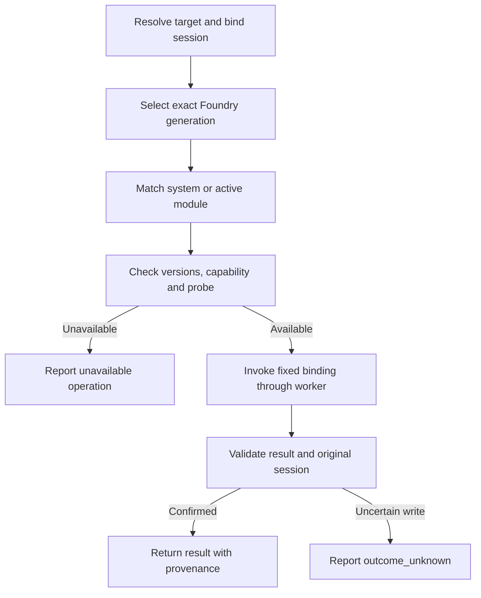

# Discussion draft: expanding Foundry integrations without coupling them to the core

**Suggested PR title:** `[Draft discussion] Target-scoped providers and independently versioned Foundry integrations`

**Status:** architectural discussion draft, with an experimental implementation available for inspection. This document does not propose treating the current code as production-validated or ready to merge.

**Historical implementation baseline:** branch `feat/multiworld-provider-overhaul`, commit [742751dfd89ab604eed00ac2ce3fd154a35b82f0](https://github.com/p4535992/foundryvtt-mcp/commit/742751dfd89ab604eed00ac2ce3fd154a35b82f0), as described in the development discussion on **2026-11-22**. This draft also records the follow-up review reported in that discussion. The evidence section distinguishes the baseline from that final pass; neither is a statement about a later revision.

The purpose of this draft is to make the expansion model concrete enough to discuss: how transports, sessions, generic document access, game rules and module workflows should coexist; how integrations should evolve with Foundry; and what evidence would be needed before accepting or supporting the design. Feedback may justify changing the implementation or splitting the work into smaller changes.

## 1. Motivation and scope

A Foundry connection exposes several kinds of behavior that can look similar at the API level but have different effects. Reading an Actor document, applying damage through a game system and transferring inventory through a module are separate contracts. Replacing one with another because a method exists, or because a module is active, can change rules, permissions, resource consumption and emitted hooks.

Version changes add another dimension. Foundry generations, system releases and module releases move together imperfectly. An integration that works with one combination should not acquire an implicit compatibility claim when its directory, upstream package or host is updated.

The expansion model should make a new integration a local package contribution, while keeping connection and execution machinery shared. Contributors should be able to maintain their adapter in a separate repository and copy a complete package into the expected location. They should not need to add module-specific routing logic to every provider.

The deployment assumption is one active world and one active game system per Foundry server, with potentially many active modules. The MCP server can manage several independent targets. This avoids selecting between multiple active systems within one target, but it does not resolve overlapping module workflows or justify a global priority among core, system and module calls.

This draft covers those boundaries and the experimental implementation that exercises them. It does not claim complete coverage of Foundry, either game system, or every module API.

## 2. Proposed ownership boundaries

The current implementation separates responsibilities as follows.

| Area | Responsibility |
|---|---|
| Target configuration | Identify the intended connection, provider, world expectations, credentials and write policy |
| Target session | Own lifecycle, world/system identity, operation ordering, reconnect fencing and integration instances |
| Provider | Connect through the configured transport and expose its actual document or runtime-execution capabilities |
| Core tools | Provide generic document reads, searches, explicit administrative edits and utilities |
| System package | Interpret system data and expose explicitly supported rule workflows |
| Module package | Expose the module's documented workflow through its public API |
| Integration host and worker | Validate contracts, select packages, evaluate availability and route fixed operation callbacks |

Providers currently include native `socketio`, historical `legacy-rest`, paired `rest-api` runtime execution and an explicit `composite` configuration. Their capabilities differ. Choosing a provider is a configuration decision; a failed mutation does not trigger automatic transport substitution.

Credentials and connections remain in the host. Python adapters receive a target-bound operation proxy instead of creating independent Foundry connections. Different targets retain separate workers and mutable adapter instances.

The [development guide](../guides/development.md) maps these responsibilities to implementation files. The [root README](../../README.md) remains a general entry point, while detailed integration claims belong in the bridge catalogs and package documentation.

## 3. Independent packages for each Foundry generation

The proposed layout makes the Foundry generation part of the package location:

```text
modules/<module-id>/13/
modules/<module-id>/14/

systems/<system-id>/13/
systems/<system-id>/14/
```

Each numeric directory is a complete package with its own manifest, adapter, bindings, probes and documentation. The shipped variants also include their authored sources, generators, examples and tests. Runtime resources and build helpers must stay within that package instead of importing code from a sibling generation.

The manifest declares an integer `foundryGeneration` matching its directory. A target reporting `14.370` selects `14/`. Generation selection precedes Python import and runtime probing. If the target reports an unknown generation, or the matching package is absent, that integration remains unavailable. It does not borrow `13/` or `14/` as a fallback.

A future `15/` package can use the same layout without adding another central ID registry. Its existence would still require an implementation and compatible upstream contract; the directory convention itself is not evidence of Foundry-15 support.

Three version identities remain independent:

| Identity | Example | Meaning |
|---|---|---|
| Foundry generation | `14` | Chooses the package directory |
| Inspected upstream release | D&D 5e `6.1.1` | Identifies the external contract used by that package |
| Adapter version | `0.2.0` | Identifies this repository's implementation |

Build minimums and upstream-version restrictions can narrow the selected generation further. A directory named `14` does not promise support for every system release on Foundry 14.

This organization deliberately duplicates some source between generations. It makes each package copyable and lets an older generation remain stable, at the cost of maintaining fixes and source pins independently. Whether that tradeoff remains manageable as the catalog grows is an explicit discussion point.

## 4. Selection, execution and failure behavior

For system/module operations, the intended flow is:



Core document operations use their provider contracts directly; this diagram describes the additional bridge path.

The host preserves exact upstream IDs in public names such as `system_{id}_{operation}` and `module_{id}_{operation}`. Callers provide validated JSON arguments, not a JavaScript body or arbitrary method path. Each operation declares input/output schemas, a fixed binding, a readiness probe and a read/write classification.

Writes require the selected target's write opt-in and the binding's runtime permissions. Rolls that can publish chat, consume resources or trigger changes are classified as writes. A successful readiness probe establishes only the checks it actually performs.

The Foundry generation is separate from the session-generation counter used to invalidate work after reconnection. Callback tokens and results stay attached to their originating operation and session. An uncertain write is reported as `outcome_unknown`, without automatic retry or replacement by a different workflow.

Integration status reports the selected `foundryGeneration`, valid local `availableGenerations` and `variantErrors`. A malformed unselected variant is diagnosable without importing it or disabling a healthy selected variant. Overlapping public-name collisions are withheld rather than resolved by load order.

## 5. Core, system and module operations need explicit semantics

The current design retains explicit operation names instead of imposing a global `module > system > core` rule.

| Intended effect | Appropriate contract |
|---|---|
| Find documents or read generic data | Core search/read operation |
| Resolve a supported skill, save, condition or rules action | Matching system operation |
| Execute a merchant, pile, currency-transfer or other module workflow | Matching active module operation |
| Intentionally edit document fields administratively | Explicit core mutation |
| Evaluate a plain dice expression | Core dice utility |

For example, directly patching HP does not establish that the system's damage workflow ran. A generic ActiveEffect operation does not establish that PF2e condition dependencies and rule effects were processed. A module transaction may add behavior beyond the corresponding system inventory change.

Bindings call methods on current runtime objects so installed document overrides and wrappers can participate. They do not force a captured base implementation. That preserves the runtime's extension mechanism, while leaving an important limitation: unknown wrappers may change arguments, effects or results in ways that a method-existence probe cannot certify.

A future intent resolver could help choose among workflows, but it is a proposal rather than implemented behavior. Such a resolver would need declared effects and prerequisites, target-specific preferences, a way to report ambiguity and provenance identifying the chosen operation. It must not choose another implementation after a mutation has been dispatched.

The [call selection guide](../guides/core-system-module-calls.md) develops these distinctions and the limitations of runtime overrides.

## 6. Current packages as implementation examples

The branch contains six generation packages:

| Package | Adapter | Inspected upstream baseline | Exposed operations |
|---|---|---|---|
| `systems/dnd5e/13/` | `0.1.1` | No Foundry-13-specific upstream baseline recorded | Original Actor-data read only |
| `systems/dnd5e/14/` | `0.2.0` | D&D 5e `6.1.1` | 25: 10 reads, 15 writes |
| `systems/pf2e/13/` | `0.1.1` | No Foundry-13-specific upstream baseline recorded | Original Actor-data read only |
| `systems/pf2e/14/` | `0.2.1` | PF2e `8.7.1` | 22: 10 reads, 12 writes |
| `modules/item-piles/13/` | `0.2.1` | Item Piles `3.3.4` | 40: 13 reads, 27 writes |
| `modules/item-piles/14/` | `0.2.1` | Item Piles `3.3.4` | 40: 13 reads, 27 writes |

D&D 5e's new operations require its inspected release and Foundry 14 build 367 or later. They cover selected Actor/Item reads, checks, saves, damage, conditions, rests and activities. Complex activity continuations, upcasting and complete concentration workflows are not established by this integration.

PF2e's new operations require its inspected release and Foundry 14 build 361 or later. They cover prepared statistics, inventory, currencies, conditions, resources, selected checks and strikes, and supported recharge behavior. Full spell casting, damage/IWR application and a complete rest workflow remain outside that coverage.

The generation-13 system packages preserve the original raw read. They do not claim that the generation-14 rules integrations were backported. Item Piles exposes selected inventory, currency, transfer, merchant, pile and vault operations in separate autonomous packages.

All variants remain experimental. Their source references and actual coverage belong in the [system catalog](../bridges/systems.md), [module catalog](../bridges/modules.md) and individual READMEs.

## 7. Contribution and external-repository workflow

An external repository can distribute the same directory structure or one complete generation directory. After reviewing the package, a contributor copies it under the matching upstream ID and generation, runs the local checks, then refreshes or reconnects the target.

There is no central integration-ID table to update. Discovery works from the filesystem. Installing an MCP adapter does not install the upstream game system or module in Foundry.

The checkout includes an offline starting-point command:

```bash
npm run create:integration -- --kind module --id example-module --foundry 14
```

Using `--kind system` creates a system package. The skeleton contains a manifest, adapter, authored source, generator, fixed binding/probe, README, recipe and test. It remains unavailable until the author implements the operation and its readiness conditions. It does not overwrite an existing variant or download code.

Generic commands discover added packages:

```bash
npm run check:integrations
npm run test:bindings
npm run test:python
```

The author still owns schema design, permission checks, upstream mapping, result handling and documentation. A copied package is trusted executable code. The host does not automatically clone repositories or install Python dependencies.

Large integrations may generate standalone bindings from package-local handlers and helper factories. This avoids distributing a runtime module graph to Foundry and keeps callers limited to fixed operations. The cost is larger generated output and a need for deterministic drift checks. Hand-authored packages do not require a generator.

## 8. Compatibility and source-reference policy

Public operation names and the original raw-read contracts are retained within the selected generation. Existing flat schema-1 third-party packages without `foundryGeneration` remain readable under their earlier policy. A flat manifest cannot coexist with numeric variants for the same ID: that layout is rejected as ambiguous.

Migrating a flat package means moving the complete unit under its intended generation, adding matching metadata and checking its paths and contracts. It should not mean changing a version label and assuming another Foundry generation works.

Core Actor/Item projection descriptors also belong to the system's generation package. Missing or unidentified variants leave generic identity/raw data and generic patch validation instead of borrowing another generation's fields or bounds.

Source selection applies to both the actual upstream product and the package's Foundry generation:

1. Prefer the latest official release compatible with that generation.
2. If the project has no releases, use the latest compatible official tag.
3. If it has neither releases nor tags, use a compatible default-branch commit and display its full hash as the upstream version.

Record the resolved commit and inspection date separately from the adapter version and live verification. A repository publishing multiple products must be filtered by the actual system/module ID. An unavailable or unexamined reference remains unknown; it is not evidence that releases are absent.

The [authoring guide](../guides/writing-integrations.md) provides the package contract and migration details.

## 9. Evidence available and validation still missing

The following results were reported for the implementation baseline:

| Check | Recorded evidence |
|---|---|
| Node binding/tooling tests | 634 passed |
| Python worker/adapter tests | 46 passed |
| Independent package copies | All six checked without sibling packages |
| Draft 7 schema/example validation | 258 schemas and 168 recipes checked |
| Recorded system operation outputs | 47 D&D/PF2e samples validated |
| Packaging and documentation | Required package assets and relative links checked |
| Full Vitest, TypeScript and Biome gates | Not completed: dependencies unavailable |
| Installed compiled integration smoke | Not completed: required dependencies and built distribution unavailable |
| Live Foundry/system/module verification | Not performed |

### Follow-up review on 2026-11-22

The final review reported three corrections to the boundaries described above:

- Core projections must respect the versions declared by their manifest, including cached descriptors.
- A composite target must reject different known Foundry generations between its core connection and runtime relay.
- PF2e must redact roll details when the actual message is hidden, even if a system-specific flag still describes it as public.

The PF2e generation-14 adapter therefore advances to `0.2.1`, with the same inspected upstream `8.7.1` baseline. The package table above includes this follow-up.

The repeated local checks reported **646 passing Node tests**, **46 passing Python tests**, and offline validation of **258 schemas and 168 recipes**. These are the final pass's results. The isolated-copy checks and 47 recorded-output validations in the baseline table remain earlier evidence and were not represented as newly repeated checks.

The new host-selection and projection tests are present, syntax-checked and reviewed, but their Vitest execution was not completed in that environment. Passing binding fixtures does not substitute for running those tests.

No variant has a populated live compatibility matrix. Source inspection, probes, local fixtures and package inclusion answer different questions from a live test with real permissions, active modules and system side effects. The [implementation record](../prps/provider-session-integration-overhaul.md) preserves the detailed evidence and its boundaries.

These gaps are reasons to discuss and validate the design before accepting operational compatibility claims.

## 10. Tradeoffs requiring agreement

Several choices need maintainer feedback beyond whether the example adapters execute their fixtures.

| Choice | Benefit being evaluated | Cost or unresolved issue |
|---|---|---|
| One package per Foundry generation | Independent evolution and copying | Duplicate fixes and maintenance across directories |
| Additional upstream-version gates | Explicit inspected contracts | Multiple incompatible upstream releases may coexist within one Foundry generation |
| Stable public tool names | Existing callers keep recognizable operations | Conflicting schemas across targets are currently withheld; future versioning needs agreement |
| Optional Python worker | Shared target-bound adapter protocol | Additional runtime, packaging and lifecycle responsibilities |
| Generated fixed bindings | Reusable authored helpers with controlled execution | Larger diffs, review burden and generator drift checks |
| Explicit core/system/module names | Visible effects and failure semantics | Callers must choose a workflow; an intent resolver would require a separate contract |
| Manual external-package installation | Simple discovery without a registry service | Update provenance, trust and dependency management remain with maintainers/users |

In particular, generation directories solve only one compatibility dimension. If a single Foundry generation needs substantially different adapters for two upstream major releases, the project must decide between internal version profiles, narrower supported baselines or a richer package-selection contract.

Similarly, identical tool names across targets are useful only when the public contract is compatible. Silently advertising one target's schema for another would hide a real mismatch. Whether explicit versioned operation names or another catalog design is preferable remains open.

## 11. Proposed review and adoption stages

A staged approach would make the discussion easier to evaluate.

1. **Agree on boundaries.** Review target ownership, provider capabilities, package identity, generation selection and explicit operation semantics. Decide whether the Python boundary and independent-directory model are acceptable.
2. **Complete automated validation.** Run the declared dependency/toolchain setup, full TypeScript/Vitest/Biome gates and installed-package smoke. Resolve failures instead of inferring success from the offline subset.
3. **Exercise real combinations.** Test disposable Foundry worlds for the declared generation and upstream versions, including write-disabled targets, non-GM users, hidden results, module wrappers, reconnection and interrupted mutations.
4. **Review migration and distribution.** Validate third-party copying, flat-package migration, package upgrades and documentation with someone who did not implement the host.
5. **Decide what can be accepted.** Consider separating shared infrastructure from individual adapters and retaining experimental status where evidence is incomplete. Populate supported combinations only after their checks are performed.

The validation and live-verification stages are currently incomplete. This draft therefore asks for architectural feedback and a validation path, without asking reviewers to assume the code is already suitable for production.

## Questions for maintainers

- Is the target/session/provider split the right boundary for adding systems and modules?
- Is a self-contained package per Foundry generation preferable to shared sources with compatibility branches, and how should fixes be tracked across generations?
- How should two incompatible upstream release families within the same Foundry generation be represented?
- Should stable operation names remain the default when multiple targets use different generations, and what is the preferred response to schema conflicts?
- Is the optional Python worker justified, or should the same package contract first be evaluated with another runtime?
- What explicit effects and prerequisites would be needed before considering an intent resolver for overlapping system/module workflows?
- Which live combinations and failure scenarios should be required before changing any adapter from experimental to supported?
- Would smaller infrastructure and adapter changes make this proposal easier to review, and which boundaries should be agreed first?

